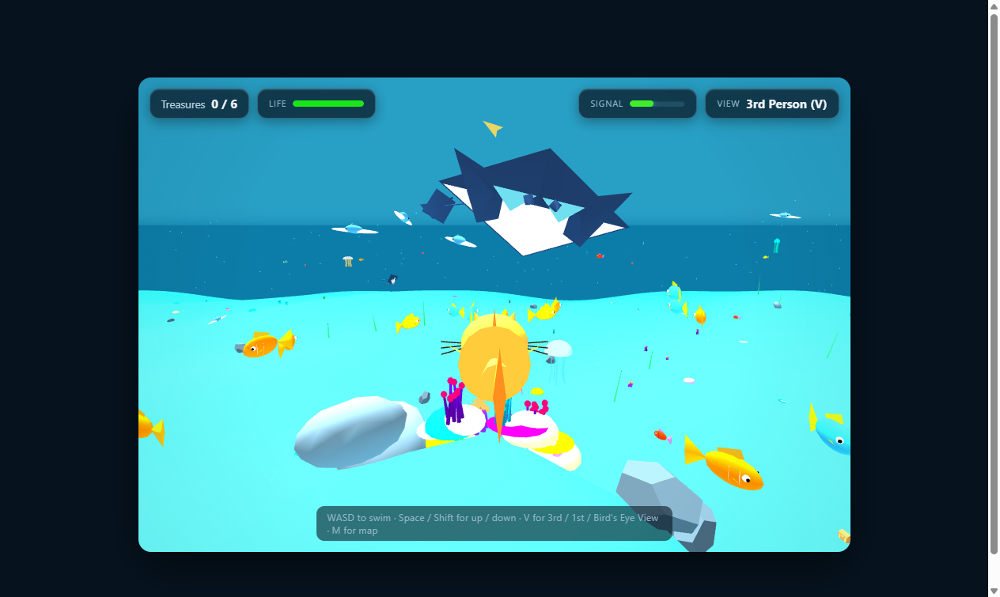

# 🐟 Catfish Treasure Hunt 3D

An open-ocean 3D underwater exploration game built with HTML5, WebGL, and Three.js. 

Play as a cat-faced fish exploring a vibrant Caribbean coral atoll, hunting hidden pirate treasure chests across a massive 6000m × 6000m oceanic expanse, while evading a lurking apex predator shark!

## 🎮 Play Online
👉 **[Play Catfish Treasure Hunt Live](https://mohsinkhan27-ai.github.io/catfish-treasure-hunt/)**

---

## ✨ Features

- **Crystal-Clear Caribbean Ocean**: Expansive 6000m ocean with sunlight rays, dynamic particle bubbles, and panoramic underwater visibility.
- **Rich Living Marine Ecosystem**:
  - 🌊 **Manta Rays**: Soaring across the sunlit upper water column with undulating wing flaps.
  - 🐬 **Dolphins**: Playful dolphin pods swimming in tandem with fluke tail animation.
  - 🐠 **Clownfish & Reef Schools**: Distinct orange-and-white clownfish darting above coral heads, plus Blue Tangs, Lemon Tangs, and Neon Tetras.
  - 🪼 **Bioluminescent Jellyfish**: Glowing translucent jellyfish pulsating at various depths.
  - 🪸 **4 Coral Varieties**: Corrugated Brain Corals, solitary Mushroom Corals, glowing Hammer Corals, and flowing Torch Corals.
- **🦈 3 Unique Apex Predators**:
  - 🦈 **Great White Shark**: Heavy hydrodynamic torpedo body with serrated teeth, patrolling the deep oceanic abyss.
  - 🔨 **Great Hammerhead Shark**: Distinct T-bar cephalofoil head with wide-set glowing eyes, patrolling seafloor trenches and hunting near buried treasures.
  - 🐟 **Giant Tiger Barracuda**: Lightning-fast silvery missile predator with tiger flank stripes, lunging at burst speeds in the sunlit upper waters.
- **3 Camera Modes**: Switch between **3rd Person Follow**, **1st Person (Catfish Eyes)**, and **Bird's Eye Panoramic View** with `V` (or on-screen button).
- **📱 Touch & Android Tablet Ready**:
  - Virtual analog thumbstick for 360° steering and propulsion.
  - Dedicated on-screen touch buttons for **Swim Up**, **Dive Down**, **Camera View**, and **Sonar Map**.
  - Adaptive dynamic viewport (`100dvh`) with safe margins ensuring 100% visibility in both portrait and landscape tablet modes.

---

## 🕹️ Controls

| Action | Desktop Keyboard | Android Tablet / Touchscreen |
| :--- | :--- | :--- |
| **Swim / Steer** | `W`, `A`, `S`, `D` or Arrow Keys | Left Virtual Joystick |
| **Ascend (Swim Up)** | `Space` or `E` | Right **▲ Up** Button |
| **Descend (Dive Down)** | `Shift`, `C`, or `Q` | Right **▼ Dive** Button |
| **Camera View** | `V` | Right **👁 View** Button |
| **Sonar Map** | `M` | Right **🗺 Map** Button |
| **Toggle Touch Controls** | Click `📱 Touch` on top bar | Tap `📱 Touch` on top bar |
